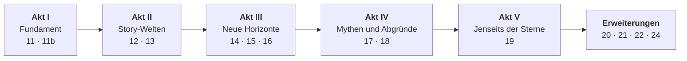

# Riftverse – Fahrplan

Was als Nächstes ins Multiversum kommt: alle geplanten Meilensteine, ihre Namen und was sie dir im Spiel bringen.

> **Stand:** 22. 11. 2026 · Der Plan kann sich noch ändern. Jeder Meilenstein wird vor dem Bauen genau abgestimmt,
> Details kommen dabei oft dazu oder fallen weg.

**Kurz gesagt:** Riftverse bekommt **17 neue Welten**, eine neue Geländeart für die Spiegelwelt und mehrere große
Erweiterungen. Am Ende gibt es **28 Universumstypen**, von friedlichen Wiesen bis zum Neon-Moloch.

---

## Die Reiseroute

Erst kommt die Technik, die alle neuen Welten brauchen. Dann die Story-Welten, weil man sie schon mit der Portal-Kanone
**Mk I** erreicht. Die aufwändigsten Welten kommen zum Schluss.

## Alle Meilensteine auf einen Blick

| Nr. | Name | Was kommt | Status |
|---|---|---|---|
| 11 | **Tiefe Fundamente** | Neuer Weltengenerator mit Überhängen, Bögen und schwebenden Bergen | ✅ fertig, kommt gleich ins Spiel |
| 11b | **Das Universums-Genom** | Kein Universum gleicht mehr dem anderen | 🔜 als Nächstes |
| 12 | **Lichter von Lumora** | Story-Welt mit schwebenden Lichtbergen | ⏳ geplant |
| 13 | **Was in der Tiefe schläft** | Story-Welt „Verlassene Minen“ mit dem Gräber | ⏳ geplant |
| 14 | **Fremde Himmel** | Planeten und zwei Sonnen am Himmel, vier ruhige Welten | ⏳ geplant |
| 15 | **Fels, Eis und Echo** | Gipfelwelt, Eiswelt, Höhlenwelt und Spiegeltürme | ⏳ geplant |
| 16 | **Versunkene Schätze** | Maya-Dschungel und Tiefsee | ⏳ geplant |
| 17 | **Himmel und Hölle** | Himmelsreich mit Gewitterzone und der Abgrund | ⏳ geplant |
| 18 | **Götter und Wächter** | Olymp mit Arenen und die Diamantwelt | ⏳ geplant |
| 19 | **Neonsterne** | Asteroidenring und Alien-Metropole | ⏳ geplant |
| 20 | **Zauber der Gleebs** | Eigene Magie, optional mit Ars Nouveau | ⏳ geplant |
| 21 | **Das Lied der Kristalle** | Kristallwächter in der Kristallwelt | ⏳ geplant |
| 22 | **Der hungrige Kern** | Singularitätskern wird zum Glücksspiel | ⏳ geplant |
| 24 | **Gemeinsam durchs Rift** | Mobs und Reittiere reisen mit dir durchs Portal | ⏳ geplant |

Die Nummer 23 gibt es nicht: Das Universums-Genom wurde als 11b nach vorne gezogen.

**Stufen der Welten:** T1 erreichst du mit der Portal-Kanone Mk I, T4 erst mit Mk IV.

---

## Akt I – Fundament

### 11 · Tiefe Fundamente

Bisher war jede Welt eine einfache Höhenkarte. Ab jetzt kann das Gelände wirklich dreidimensional sein: Überhänge,
Felsbögen, schwebende Berge und riesige Höhlen. Welten können außerdem in Regionen mit eigenem Charakter aufgeteilt
werden. Du siehst davon noch keine neue Welt, aber jede kommende Welt baut darauf auf.

### 11b · Das Universums-Genom

**Kein Universum gleicht dem anderen.** Jedes Zufallsuniversum würfelt beim Entstehen 15 Merkmale aus, zum Beispiel
Berghöhe, Wasser, Schroffheit, schwebende Inseln, Schluchten, Höhlen, Vegetation, Wunder und Rohstoffe. Zwei Besuche in
derselben Welt-Art können sich dadurch völlig verschieden anfühlen: einmal sanfte Hügel, einmal zerklüftete Nadeln.

- Gilt auch für die bestehenden Welten.
- Der **Weltenformer** lässt dich die Merkmale beim Züchten beeinflussen, du bekommst also eher die Welt, die du willst.
- Die Story-Welten bleiben, wie sie sind.
- ⚠️ Schon erkundete Zufallsuniversen werden dafür voraussichtlich zurückgesetzt. Was du dort gebaut hast, kann
  verloren gehen.

## Akt II – Die Story-Welten

Drei Welten sind **einzigartig**: Es gibt jede nur einmal, sie ändert sich nie und merkt sich ihren Stand. Was dort
passiert, gilt für alle Spieler. **Bridge's Inn** ist schon im Spiel, zwei weitere folgen.

### 12 · Lichter von Lumora

Riesige Felsberge schweben 150 bis 300 Blöcke über einem Regenwald, Wasserfälle stürzen von ihren Rändern ins Leere.
Nachts leuchtet alles in Türkis, Violett und Magenta, und am Himmel hängt ein blasser Gasriese.

- **Acht Regionen** mit eigener Stimmung, darunter Kronenwald, Sporental, Leuchtsumpf und Wurzelkathedrale
- **Rund 36 Pflanzen**, die nachts zu leuchten beginnen
- Riesige Wunderorte wie der **Mutterbaum** als Wegmarken
- Kreaturen: sechsbeinige Grasfresser, fliegende Rochen und ein nächtliches Raubtier, das sich durch sein Leuchten verrät
- Neuer Rohstoff **Lumenharz** für Lichtbauteile, Linsen und ein Nachtsicht-Modul

### 13 · Was in der Tiefe schläft

Die **Verlassenen Minen**: Tagebaugruben führen 200 Blöcke tief in Stufen hinab, überall stehen verrostete Bagger, Kräne
und Förderbänder. Die Arbeiter haben zu tief gegraben und etwas geweckt.

- Notizen, abgebrochene Dienstpläne und Kratzspuren erzählen nach und nach, was passiert ist
- Ganz unten lebt der **Gräber**, der von Geräuschen angelockt wird. Wer laut abbaut, ruft ihn
- Fair für Anfänger: Die oberen Ebenen sind sicher, der Gräber warnt vorher und lässt sich durch Flucht abhängen
- Neuer Rohstoff **Tiefenerz**, ein Mischerz für Eisen, Kupfer und Zinn zugleich, eine echte Abkürzung für Mutige

## Akt III – Neue Horizonte

### 14 · Fremde Himmel

Der Himmel wird lebendig: Planeten, Monde, mehrere Sonnen und Polarlichter. Lumora bekommt damit seinen echten Gasriesen.
Dazu vier ruhigere Welten:

- **Steppe:** goldgrünes Gras bis zum Horizont, Wildpferdherden, Bisons und Steppenadler
- **Doppelsonnen-Wüste:** Dünen, gestreifte Tafelberge und ein doppelter Sonnenuntergang, Sandwürmer unter dem Sand
- **Weiße Ebene:** eine endlose weiße Fläche ohne Horizont, ohne Geräusche, ohne Schatten. Selten und unheimlich still
- **Fremde Heimat:** sieht aus wie die normale Overworld, bis dir auffällt, was nicht stimmt. Viereckige Sonne? Wasser,
  das nach oben fließt? Dorfbewohner mit deinem Gesicht?

### 15 · Fels, Eis und Echo

- **Gipfelwelt:** Berge bis Y 560, Wolken unter dir in den Tälern, Felsbögen mit 200 Blöcken Spannweite. Oben wird die
  Luft dünn
- **Eiswelt:** kilometerlange Gletscher, blau leuchtende Spalten und Polarlichter. Ohne isolierte Rüstung frierst du,
  und im Eis schlafen uralte Kreaturen
- **Höhlenwelt:** keine Oberfläche, nur riesige Hallen mit Pilzwäldern, Kristallgrotten und unterirdischen Seen
- **Spiegeltürme:** neues Gelände für die Spiegelwelt, schmale Nadeln mit Wänden aus Spiegel

### 16 · Versunkene Schätze

- **Maya-Dschungel:** Stufenpyramiden ragen aus dem Blätterdach, darin Fallen und Schätze. Dazu Cenoten, Ballspielplätze,
  Jaguare und Schlangen
- **Tiefsee:** ein Ozean ohne Land, Korallenriffe, Kelpwälder und Walskelette. In der Tiefe leuchtet alles, und in den
  Gräben jagt etwas Großes

## Akt IV – Mythen und Abgründe

### 17 · Himmel und Hölle

- **Himmelsreich:** Marmorinseln mit goldenen Tempeln über einem Wolkenmeer, verbunden durch begehbare
  Regenbogenbrücken. Himmelswale, Aufwinde zum Gleiten und Statuen, die erwachen, wenn du plünderst
- **Die Gewitterzone darunter:** Wer fällt, landet im „Sturz der Titanen“: versteinerte Riesen, zerbrochene Götterwaffen
  und ein ewiges Gewitter. Der Weg zurück nach oben ist ein Abenteuer für sich
- **Hölle:** ein gewaltiger Schlund mit Lavafällen, Obsidiantürmen und Inseln an riesigen Ketten. Die gefährlichste Welt
  bis T3

### 18 · Götter und Wächter

- **Olymp:** türkises Meer, weiße Klippen, Marmortempel und riesige Arenen. Starte selbst eine Arena-Herausforderung:
  Wellen von Monstern und am Ende ein Champion. Mit Zyklop, Harpyien und einer Hydra, der Köpfe nachwachsen
- **Diamantwelt:** Diamanten, so weit das Auge reicht. Doch wer abbaut, ruft die **Seraphen**: lautlose Lichtwesen mit
  riesigen Augen und kreisenden goldenen Ringen. Ab dem zehnten Diamanten greifen sie an

## Akt V – Jenseits der Sterne

### 19 · Neonsterne

- **Asteroidenring:** Du stehst auf einem Felsbrocken, ein Planet füllt den halben Himmel. Wenig Schwerkraft, kein
  Sauerstoff, Meteoritenschauer
- **Alien-Metropole:** eine Stadt bis zum Horizont, Türme, Neon, Schwebebahnen und Märkte. Quantenchips kannst du ehrlich
  kaufen oder stehlen, aber dann jagen dich die Polizei-Drohnen

## Erweiterungen

| Nr. | Name | Was sich ändert |
|---|---|---|
| 20 | **Zauber der Gleebs** | Ein Zauberstab mit 5–6 Zaubern, Zutaten aus Leuchtpflanzen und Sternenstaub. Mit **Ars Nouveau** kommen zusätzliche Rezepte, Handel und Beute dazu, ohne läuft alles ganz normal |
| 21 | **Das Lied der Kristalle** | In der Kristallwelt wachen Kristallwächter, die das Abbauen hören. Ein leises Gadget hilft, unbemerkt zu bleiben |
| 22 | **Der hungrige Kern** | Der Singularitätskern frisst in viel größerem Umkreis alles außer Bedrock, auch Maschinen, Kisten und unvorsichtige Spieler. Viel Strom gegen echtes Risiko. Mit dem Eindämmungsring bleibt er völlig sicher |
| 24 | **Gemeinsam durchs Rift** | Mobs landen dort, wo du landest, wie beim Netherportal. Reittiere mit Reiter, Tiere an der Leine und Mobs in Booten und Loren kommen mit. Bosse bleiben zu Hause |

---

## Alle neuen Welten

| Welt | Stufe | Rohstoff | Gefahr |
|---|---|---|---|
| Lumora | T1 · Story | Lumenharz | nächtliches Raubtier |
| Verlassene Minen | T1 · Story | Tiefenerz | der Gräber in der Tiefe |
| Steppe | T1 | Windgras | Wolfsrudel bei Nacht |
| Doppelsonnen-Wüste | T1 | Sonnenglas | Hitze, Sandstürme, Sandwürmer |
| Weiße Ebene | T1 · selten | Leerfaser | keine |
| Fremde Heimat | T1 | Trugeisen | keine, nur seltsam |
| Gipfelwelt | T2 | Höhenquarz | dünne Luft, Lawinen |
| Eiswelt | T2 | Kryokristall | Kälte, Schneestürme |
| Höhlenwelt | T2 | Echostein | Dunkelheit, blinde Höhlenwesen |
| Maya-Dschungel | T2 | Jadestein | Fallen, Jaguare |
| Tiefsee | T2 | Tiefenperle | Sauerstoff, Druck, Tiefseejäger |
| Himmelsreich | T3 | Sonnengold und Donnerstein | Tempelwächter, Gewitterzone |
| Hölle | T3 | Höllenschmelze | Hitze, Lavaregen |
| Olymp | T3 | Orichalkum | Arenen, mythische Monster |
| Diamantwelt | T4 · sehr selten | Herzdiamant | Seraphen |
| Asteroidenring | T4 | Meteoreisen | kein Sauerstoff, Meteoriten |
| Alien-Metropole | T4 | Quantenchips | Polizei-Drohnen |

Jede Welt hat einen eigenen Rohstoff, den es nirgends sonst gibt, und jeder steckt in mindestens einem Rezept. Keine Welt
empfängt dich mit einem Bossfight: Die Gefahr beginnt erst, wenn du etwas tust.

## Am Horizont

Ideen für die Zeit nach diesem Plan, noch ohne festen Termin:

- **Großer Story-Modus**, der dir durchs Multiversum folgt
- **Riftverse als FTB-Modpack**, sobald der Mod rund läuft
- **Eigener Story-Fortschritt pro Spieler**, damit Neulinge auf einem Server nichts verpassen
- **Eine zweite Story-Welt öffnen**, zum Beispiel eine frische Lumora, mit einem besonderen Gegenstand
- **Ursprungsuniversen**: zu jedem Welttyp eine seltene, einzigartige Urversion mit eigener Geschichte

---

Made by David Chapman
